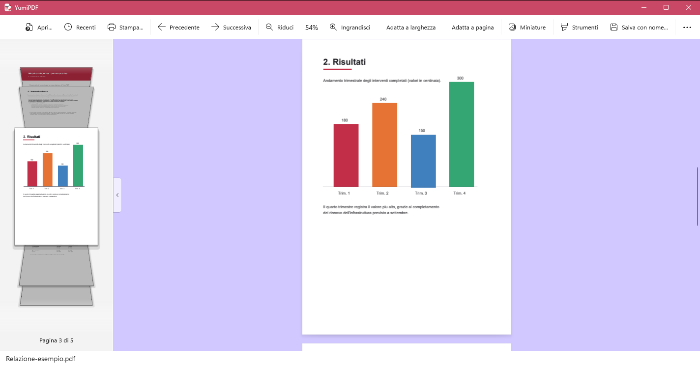
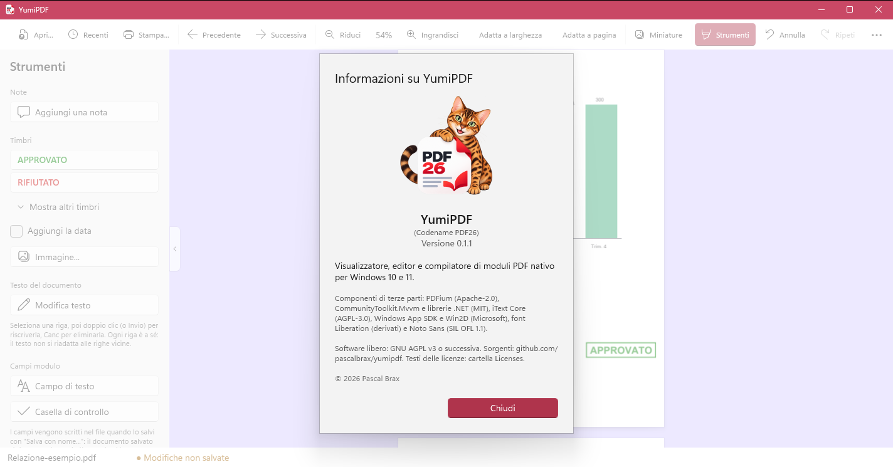

# YumiPDF

> Il nome dell'app è YumiPDF (l'eseguibile è `YumiPDF.exe`); alcuni nomi interni (namespace `Pdf26`, cartella delle
> impostazioni in `%LocalAppData%/PDF26`, chiavi private nei PDF) restano quelli originali, perché l'utente non li vede.

Visualizzatore, editor e compilatore di moduli PDF nativo per Windows 10 e 11.

## Screenshot

Un documento con la barra delle miniature (Cover Flow verticale a sinistra):



Il pannello "Strumenti" (note, timbri, modifica del testo, campi modulo) e la finestra "Informazioni":



(Il documento mostrato è un esempio generato per l'occasione.)

## Funzionalità (stato attuale - vedi [docs/ROADMAP.md](docs/ROADMAP.md))

- Apertura da riga di comando di file locali, percorsi UNC di rete e URL HTTP/HTTPS pubblici
- Visualizzazione a scorrimento continuo di tutte le pagine (rendering PDFium), con placeholder
  dimensionati subito e bitmap popolati progressivamente
- Zoom (+/-, percentuale) e adatta a larghezza/pagina
- Apertura di documenti protetti da password, con richiesta e nuovo tentativo in caso di errore
- Sfondo dell'area pagina personalizzabile (menu Opzioni)
- Associazione col tipo file `.pdf` attivabile/disattivabile dal menu Opzioni (mai automatica)
- Unione, suddivisione e riordino di PDF
- Compilazione di moduli AcroForm dal pannello "Compila modulo": campi di testo e checkbox/radio,
  con anteprima live del valore appena scritto sulla pagina; salvataggio con nome, con appiattimento
  opzionale (rende i valori permanenti, non più modificabili in quella sessione)
- Annotazione di evidenziazione
- Pannello "Recenti" nella barra laterale con gli ultimi documenti aperti (la barra mostra un solo pannello alla volta: Miniature, Indice, Strumenti, Compila modulo, Cerca, Recenti)
- Campi di testo e caselle di controllo compilabili che si aggiungono al PDF dal pannello "Strumenti" (nome,
  suggerimento, obbligatorio, sola lettura, multilinea, dimensione del carattere, spuntata di default)
- Modifica del testo già presente nelle pagine (pannello "Strumenti" > "Modifica testo"): si seleziona una riga, la si
  riscrive o la si elimina. Se il font del documento (di solito un sottoinsieme) non ha le lettere digitate, la riga
  è riscritta con un font open source incorporato di aspetto simile (Liberation/Noto Sans, SIL OFL)
- Annulla/Ripeti (Ctrl+Z, Ctrl+Y; pulsanti in barra con il pannello "Strumenti" aperto) per note, timbri, campi aggiunti e modifiche al testo
- Pannello "Strumenti" con note e timbri da inserire sulle pagine: nota con testo, timbri testuali (APPROVATO, BOZZA, ... con data opzionale)
  o con un'immagine propria; si selezionano, spostano, ridimensionano (timbri) ed eliminano; "Salva con nome..."
  le scrive nel nuovo file come annotazioni PDF standard (le vedono anche gli altri lettori)
- Stampa con anteprima nel pannello nativo di Windows (stampante, intervallo di pagine, copie, orientamento, carta; include
  modifiche, annotazioni e moduli compilati senza doverli salvare) - vedi [docs/STAMPA.md](docs/STAMPA.md)
- Selezione del testo per trascinamento (solo pagine con testo nativo), con copia automatica negli appunti
- Navigazione dall'indice del documento (segnalibri) nella barra laterale, in alternativa alle miniature
- Firme digitali: banner e indicazione nella barra di stato per i documenti firmati, con verifica che il
  contenuto non sia stato modificato dopo la firma (non verifica l'attendibilità del certificato - vedi
  [docs/ARCHITECTURE.md](docs/ARCHITECTURE.md))
- Finestra "Informazioni" (versione, licenze di terze parti)
- Indicazione (barra di stato e banner in alto) se il documento aperto si autodichiara PDF/A (letta dai suoi
  metadati XMP - non una validazione completa, vedi [docs/ARCHITECTURE.md](docs/ARCHITECTURE.md))

L'installer e gli aggiornamenti automatici sono pianificati nelle milestone successive - vedi la roadmap.

## Requisiti di sviluppo

- Windows 10/11
- Visual Studio 2022 (17.12+) con i workload **.NET Desktop Development** e **Windows App SDK C#**
  (necessario per compilare `src/App`, il progetto WinUI3 - la build da riga di comando richiede comunque
  gli stessi componenti del Windows SDK installati da questi workload)
- .NET SDK 10.0+ (già installato in questo ambiente)

## Struttura

```
26PDF.slnx
├── src/PdfEngine    Libreria PDFium (rendering, merge/split, annotazioni, moduli). Nessuna dipendenza UI.
├── src/Printing     Copia indipendente del PDF per la stampa, geometria e intervalli di pagine (nessuna UI).
├── src/App          App WinUI3 (Windows App SDK), unpackaged, installer MSI/EXE previsto.
├── tests/PdfEngine.Tests
├── docs/            Architettura e roadmap
└── installer/       Note per la fase di packaging (non ancora implementato)
```

Dettagli architetturali (perché PDFium, come funziona la stampa con anteprima, l'unico punto delicato del codice nativo)
in [docs/ARCHITECTURE.md](docs/ARCHITECTURE.md).

## Build

```bash
dotnet build 26PDF.slnx -c Debug
```

Per compilare/pubblicare solo l'app per un RID specifico (necessario per `publish`, non per `build`;
fare prima una build della solution completa - il compilatore XAML di WinUI3 a volte non risolve i tipi
del progetto se viene invocato isolatamente prima che esista una build precedente):

```bash
dotnet build src/App/App.csproj -c Debug -r win-x64
```

Test:

```bash
dotnet test tests/PdfEngine.Tests/PdfEngine.Tests.csproj
```

Avvio con un documento passato da riga di comando (locale, UNC o URL):

```bash
dotnet run --project src/App/App.csproj -- "C:\percorso\file.pdf"
dotnet run --project src/App/App.csproj -- "\\server\condivisione\file.pdf"
dotnet run --project src/App/App.csproj -- "https://example.com/file.pdf"
```

## Licenza

YumiPDF è software libero: si distribuisce secondo i termini della **GNU Affero General Public License, versione 3 o
(a tua scelta) successiva** - vedi [LICENSE](LICENSE). Copyright © 2026 Pascal Brax.

La scelta dipende da iText Core (AGPL-3.0 o successiva), che l'app usa per creare i campi modulo: un programma che lo include
e viene distribuito deve essere a sua volta AGPL. Chi riceve l'app (anche lo zip portable) ha diritto ai sorgenti, qui su
GitHub, alle stesse condizioni. L'alternativa è una licenza commerciale di iText. Valutato anche PDFsharp (MIT): non può creare
campi, i costruttori sono `internal`.

## Licenze di terze parti

L'elenco completo, con versioni, licenze, riconoscimenti obbligatori e punti ancora aperti, è in
[THIRD-PARTY-NOTICES.md](THIRD-PARTY-NOTICES.md); i testi delle licenze sono in [`third-party-licenses/`](third-party-licenses/)
e, nel pacchetto, nella cartella `Licenses/` accanto all'eseguibile. In sintesi:

- Apache-2.0: PDFium (con il codice di terzi che contiene: FreeType, libpng, libjpeg-turbo, zlib, ICU, ...)
- MIT: CommunityToolkit.Mvvm, librerie Microsoft .NET, .NET runtime
- **SIL OFL 1.1**: font Liberation 2.1.5 (Sans, Serif, Mono; ridotti a latino/greco/cirillico e *rinominati* "PDF26 ...", perché
  la OFL riserva il nome "Liberation" alle versioni non modificate) e Noto Sans
- **AGPL-3.0 o successiva**: iText Core 9
- **Contratti Microsoft** (non open source): Windows App SDK e Win2D (disegno delle pagine nel pannello di stampa). La loro
  compatibilità con l'AGPL è il punto ancora aperto - vedi THIRD-PARTY-NOTICES.md
